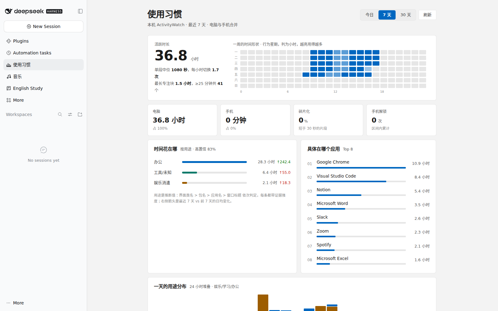
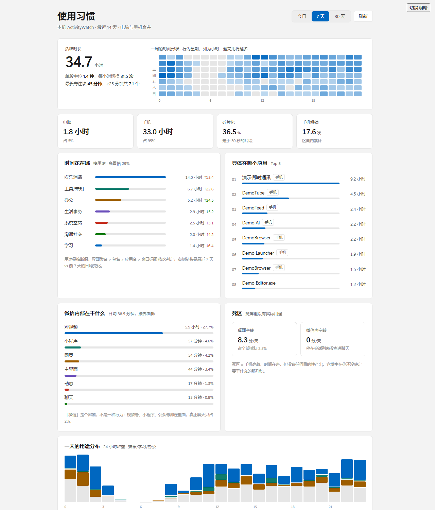

# dsh-aw-viz

[](https://github.com/woshijing1991-cloud/dsh-aw-viz/actions/workflows/ci.yml)
[](LICENSE)
[](https://github.com/woshijing1991-cloud/dsh-aw-viz)

An **ActivityWatch habit dashboard** for the DeepSeek Harness: one panel with five lenses —
time allocation, fragmentation, focus blocks, hourly rhythm, and PC-vs-phone split —
computed on your own machine and strictly read-only.

**Its job is not to judge your day — it is to make your own usage data readable by an AI.**
The plugin turns raw ActivityWatch records into metrics with stated definitions and exposes them
through the `aw_habit_report` tool, so the assistant in the same session can read the numbers and
propose concrete, personalised changes to how you use your screens. The plugin stays deterministic
and local; the judgement and the suggestions come from the model.

> Third-party plugin for the DeepSeek Harness ecosystem — not an official project.
> Built for Harness 0.2.x desktop (Web frontend).


*The real panel code rendering a synthetic ActivityWatch stub — no real usage records are included.*

---

## Prerequisites

- **ActivityWatch must already be installed and running** — this panel is a read-only view over it and collects nothing by itself.
- Default endpoint: `http://127.0.0.1:5600` (the `aw-server` / `aw-server-rust` REST API). Point it elsewhere with the `activityWatchBase` config option.
- If ActivityWatch is not running the panel does not break: `/api/health` answers `200` with `{"ok": false, "error": "fetch failed"}` and the summary route returns `500`, so the UI shows an empty state instead of inventing numbers.
- Verified in a clean headless environment: with ActivityWatch running, every route answers `200` and the model tool returns real aggregates.

## What it measures

Each metric below has an external reference, so the numbers are not home-made heuristics.

| Dimension | Metrics | Grounding |
|---|---|---|
| Time allocation | Share by category, top apps, PC vs phone split | RescueTime's productivity-pulse / category-share convention |
| Fragmentation | Median segment length, switches per active hour, share of segments < 30 s | Mark et al. 2008, *The Cost of Interrupted Work*; Leroy 2009, *attention residue* |
| Focus | Longest uninterrupted same-category block, count of blocks ≥ 25 min | *Deep Work* (Newport); ultradian rhythm (~90 min) |
| Rhythm | Weekday × hour heatmap (7×24), per-day trend | Chronotype framing and Digital Wellbeing's hourly view |
| Dual device | PC minutes / phone minutes / PC share, phone unlock count | Apple Screen Time's *pickups* convention |
| Completeness | Count and length of power-off gaps | A locally created `aw-offline` marker, so "no records" is never mistaken for "no activity" |

Definitions worth knowing before you read the numbers:

- **Active time** = window events ∩ non-AFK intervals. The PC has an AFK watcher; the phone does not,
  so phone time is counted directly from event durations.
- **Fragmentation uses the median, not the mean**: a few long blocks inflate the mean, and the mean
  then hides what a *typical* stretch actually looks like.
- **Focus blocks** accumulate same-category segments with gaps ≤ 2 minutes. It measures "how long you
  were not torn away", not "how focused you believe you were".
- Phone granularity stops at **app level** (an Android limitation); in-app pages are not available.

## Where the data comes from

The plugin never stores usage history. Every time the panel opens it asks the local `aw-server`
(default `http://127.0.0.1:5600`) for events and aggregates them in memory.

- Nothing is written to disk by the dashboard itself.
- Requests only go to loopback; the plugin has no outbound network behaviour.
- ActivityWatch keeps the raw database. Its location depends on your own ActivityWatch install —
  this repository does not assume or require any particular path.

## Endpoints and the model tool

The host half registers two read-only routes under `basePath` (default `/dsh-aw-viz`):

```
GET /dsh-aw-viz/api/summary?days=7   # all metrics
GET /dsh-aw-viz/api/health           # probe whether aw-server is running
```

Plus one read-only tool for the model, so you can just ask in chat:

| Tool | Arguments | Returns |
|---|---|---|
| `aw_habit_report` | `days` (1–90, default from config), `format` (`text` \| `json`) | A readable summary or the raw metrics |

## Where it mounts

Two registrations, following the same pattern as the host's own plugin / automation / context panels:

| Part | Slot | Notes |
|---|---|---|
| Sidebar entry | `sidebar.panellist` | `{ id: 'aw-viz', order: 20, label: () => '使用习惯' }` plus an icon component; the host renders the row itself, so typography and hover states match its neighbours |
| Panel body | `main` | `{ key: 'aw-viz' }`, selected with `ctx.layout.selectPanel('aw-viz')` when the row is clicked |

`order`: plugins = 0, automation = 10, this panel = 20, skills = 31.

An early version registered into `sidebar.brand.mark` (the 24px brand slot). That is an icon slot,
not a list — abandoned.

## Install

Requirements: DSH desktop (Harness 0.2.x, Web frontend), Node 20+, and a running
[ActivityWatch](https://activitywatch.net/) with data in it.

The panel HTML/JS is baked into the page at host startup, so **every install path ends with an app restart**.

### 1. Clone and install as a local `file:` plugin (recommended)

```sh
git clone https://github.com/woshijing1991-cloud/dsh-aw-viz.git
cd dsh-aw-viz

# let the host write the profile for you (best option)
dsh plugin --profile <your-profile> add "$(pwd)"
```

Restart DSH. Keep the checkout somewhere stable: the profile references it as a `file:` dependency,
so moving or deleting the folder makes the profile fail to load.

### 2. Plugin marketplace

If your DSH build has a plugin marketplace and this package is listed there, install it from the
marketplace UI and restart. Nothing else to configure.

### 3. Manual profile configuration

Three places must agree — a dependency without a `cordis.patch.yml` `insert` entry loads but never
mounts, which looks exactly like "installed, nothing happened".

`~/.dsh/profiles/<profile>/package.json`:

```json
{
  "dependencies": {
    "dsh-aw-viz": "file:/absolute/path/to/dsh-aw-viz"
  },
  "dsh": {
    "profile": {
      "bundles": ["dsh-aw-viz"]
    }
  }
}
```

`~/.dsh/profiles/<profile>/cordis.patch.yml`:

```yaml
- insert:
    - id: dsh-aw-viz
      name: 'dsh-aw-viz'
      config:
        activityWatchBase: 'http://127.0.0.1:5600'
        basePath: '/dsh-aw-viz'
        defaultRangeDays: 7
```

Then:

```sh
cd ~/.dsh/profiles/<profile> && pnpm install
```

and restart DSH.

### Uninstall

Remove the `dependencies` entry, the `dsh.profile.bundles` entry and the `insert` block, run
`pnpm install` again, restart.

## Configuration

Profile config keys (written into the patch layer by the install entry):

| Key | Default | Meaning |
|---|---|---|
| `activityWatchBase` | `http://127.0.0.1:5600` | Base URL of your local `aw-server`; change it if ActivityWatch listens elsewhere |
| `basePath` | `/dsh-aw-viz` | URL prefix for the two routes; change it if it collides with another plugin |
| `defaultRangeDays` | `7` | Default window when a request does not specify `days` |

Environment variables used by the optional scripts in `tools/` (never by the plugin at runtime):

| Variable | Default | Meaning |
|---|---|---|
| `AW_BASE` | `http://127.0.0.1:5600` | Same `aw-server` endpoint for the export scripts |
| `AW_DATA_DIR` | `<repo>/aw-data` | Where the scripts write CSV / JSON / weekly reports. Git-ignored |
| `AW_TZ_CONFIG` | `$AW_DATA_DIR/user-tz.json` | Timezone-offset file written by `tools/tz-normalize.mjs` and read by the stats module |
| `AW_TZ_OFFSET_HOURS` | *system timezone* | Force a fixed offset (e.g. `8`, `-5`). Highest priority; use it when you want a specific zone rather than the machine's |

The plugin reads `AW_TZ_CONFIG` / `AW_TZ_OFFSET_HOURS` too, so the heatmap buckets hours by *your*
timezone instead of the machine's system timezone. Your system clock and timezone are never modified.

> **If you travel or run the host on a server in another region**, set `AW_TZ_OFFSET_HOURS`
> explicitly. It defaults to the host's system timezone; with a wrong offset the 7×24 heatmap and the
> 24-hour breakdown shift as a block, which looks like the plugin mis-bucketed your day.

## Local preview without the host

`preview.html` renders the dashboard from a bundled snapshot, so you can iterate on `lib/page.css`
without restarting DSH. Open the file directly; `?scheme=dark` switches the theme.


*`preview.html` opened directly — the same demo snapshot, no DSH, no ActivityWatch.*

Add `?live=1` to pull real data instead. Inside a `file://` page you must name the host explicitly:

```
preview.html?live=1&base=http://127.0.0.1:<dsh-port>
```

CSS has exactly one source of truth: `lib/page.css`. The client plugin cannot ship a `<link>`, so
`tools/build-client.mjs` inlines it into `lib/client.template.js` and writes `lib/client.js`:

```sh
node tools/build-client.mjs          # rebuild after editing page.css
node tools/build-client.mjs --check  # verify only, exit 1 on drift
```

Design decisions worth keeping (see the `frontend-design` skill for the reasoning):

| Decision | Why |
|---|---|
| The hero visual is a 7×24 heat grid, not a big number | Time is continuous — express it as a shape. Big number + gradient is the most templated choice available |
| The heat grid is capped at 660px | 24 columns across the full width turn into a barcode; intraday variation disappears |
| Six paired `light-dark()` series colours | One token, one step per theme; nothing goes muddy in dark mode |
| KPIs use a 2px left colour bar instead of a card shadow | Avoids the "identical rounded cards + one soft shadow" template look |
| All metric figures use `tabular-nums` | Digits line up for vertical comparison while scanning |
| The x-axis has five evenly spaced dates plus a peak marker | Labelling only the first and last date is the same as not labelling |

## Scrolling and container constraints

The host's centre column is `display: flex; flex-direction: column; overflow: hidden`.
It **clips and does not scroll** — scrolling is the panel's own responsibility. If the panel root does
not become a scroll container, overflowing content is cut off and the page cannot be scrolled at all
(the symptom: "renders wrong and won't scroll").

```css
.aw-page   { height:100%; min-height:0; display:flex; overflow:hidden }
.aw-inner  { flex:1; min-height:0; overflow:auto; scrollbar-gutter:stable }
```

The root node also carries an inline `{height:100%, overflowY:auto}` fallback, so even if the stylesheet
is blocked the panel does not end up clipped and unscrollable.

## Tools

| Script | Purpose |
|---|---|
| `tools/build-client.mjs` | Inline `page.css` into `lib/client.js` (`--check` for CI) |
| `tools/smoke.mjs` | Offline self-check: build drift, demo-data shape, rule hits, no absolute paths |
| `tools/export-sample.mjs` | Export a snapshot of your own data for `preview.html` — **contains real records, do not commit** |
| `tools/classify-export.mjs` | Classify every record by purpose and export a CSV |
| `tools/weekly-report.mjs` | Week-vs-week Markdown report focused on the few actionable metrics |
| `tools/night-watch.mjs` | Check last night's late usage against a threshold |
| `tools/tz-normalize.mjs` | Derive your real timezone offset and persist it (never touches system settings) |

Every path above comes from `tools/env.mjs`, so a fresh clone writes under `./aw-data/` until you point
`AW_DATA_DIR` somewhere else.

## Development

```sh
npm run build    # page.css -> client.js
npm run check    # fail if client.js is stale
npm test         # offline smoke test
```

Conventions worth keeping:

- **The host half imports only Node built-ins and relative files.** The profile's `node_modules` has no
  `@deepseek-ai/*`; a static import of those fails before the plugin ever activates.
- **Every registration is wrapped in its own try/catch.** One bad schema should not take down the profile.
- **The panel owns its scrolling**, per the constraint above.

## Compatibility

- DeepSeek Harness 0.2.x desktop, Web frontend (`platform: web` client bundle).
- Needs a reachable ActivityWatch `aw-server`; without it the panel shows a state message instead of numbers.
- Node 20+ (global `fetch`, ESM).
- Host-version sensitive: the panel registers into `sidebar.panellist` + `main`. A host release that
  renames those slots would drop the panel entry, but would not break startup.
- If `Uncategorized` stays high, the rules need feeding — they live in `lib/stats.js` (`CATEGORY_RULES`),
  and order is significant.

## Privacy

- **Read-only and local.** Only `GET` requests to your own ActivityWatch over loopback. No telemetry,
  no remote assets, no upload.
- **The dashboard stores nothing.** Aggregation happens in memory, per request.
- **This repository ships synthetic demo data only** (`lib/sample-summary.js`). App names and dates in it
  are invented and the numbers are scaled; it is a rendering fixture, not anyone's history.
- If you export your own snapshot with `tools/export-sample.mjs`, that file contains real records — it is
  documented as do-not-commit, and `git checkout -- lib/sample-summary.js` restores the demo data.
- No credentials are involved: the plugin does not read cookies, tokens, `.env` files or ActivityWatch
  databases. It talks to the HTTP API only.

## License

MIT — see [LICENSE](LICENSE). Copyright (c) 2026 CCC (woshijing1991-cloud).

---

# dsh-aw-viz（中文）

一个 **ActivityWatch「使用习惯」看板**插件：把本机 ActivityWatch 的活动数据做成 DSH 界面里的可视面板——
时间分配、碎片化、专注块、时段节律、电脑与手机分账，五个视角一屏看完。全部在本机计算，**只读**。

**它的定位不是替你评判这一天，而是把手上的使用数据变成 AI 读得懂的指标。**
插件负责把 ActivityWatch 的原始记录算成口径明确的数据，并通过 `aw_habit_report` 工具暴露给同一个会话里的模型；
真正的分析与建议由 AI 给出——根据这些指标判断你的使用模式哪里值得改，再给出可执行的个性化方案
（什么时候该停、哪类应用在吃时间、碎片化是不是变严重了）。插件本身保持确定性、纯本地，不下判断、不联网。

> 本插件属于 DeepSeek Harness 生态的第三方插件，不是官方项目。适配：Harness 0.2.x 桌面端（Web 前端）。


*由真实面板代码渲染；数字来自虚构的 ActivityWatch 桩，不含任何真实记录。*

---

## 前提条件

- **本机已经装好并正在运行 ActivityWatch**——这个面板只是它的只读视图，自己不采集任何数据。
- 默认读 `http://127.0.0.1:5600`（`aw-server` / `aw-server-rust` 的 REST API），换地址改 `activityWatchBase` 配置项。
- ActivityWatch 没起来时面板不会崩：`/api/health` 返回 `200` 但 `{"ok": false, "error": "fetch failed"}`，汇总接口返回 `500`，界面显示空状态而不是编造数字。
- 已在干净的 headless 环境实测：ActivityWatch 在跑时所有路由 `200`，模型工具返回真实聚合值。

## 它分析什么

每一项都对应一个既有框架，不是随手编的口径。

| 维度 | 指标 | 依据 |
|---|---|---|
| 时间分配 | 分类占比、Top 应用、电脑/手机分账 | RescueTime 的 Productivity Pulse / 类别占比口径 |
| 碎片化 | 单段时长中位数、每活跃小时切换次数、短段（<30 秒）占比 | Mark et al. 2008《The Cost of Interrupted Work》；Leroy 2009「attention residue」 |
| 专注 | 最长连续同类段、≥25 分钟的块数 | 《Deep Work》(Newport) / 超日节律（约 90 分钟周期） |
| 节律 | 周一~周日 × 0-23 时热力图、逐日趋势 | chronotype（晨型/夜型）与 Digital Wellbeing 的 hourly 视图 |
| 双端 | 电脑分钟数 / 手机分钟数 / 电脑占比、解锁次数 | Apple Screen Time 的 pickups 口径 |
| 完整性 | 关机空档段数与分钟数 | 本机自建的 `aw-offline` 标记，避免把「没记录」误读成「没活动」 |

读这些数字之前值得先知道的三件事：

- **活跃时长** = 窗口事件 ∩ 非 AFK 区间。电脑端有 afk watcher；手机端没有，按事件时长直计。
- **碎片化看中位数而不是平均值**：平均值会被少数长块拉高，中位数才反映「典型的一段有多长」。
- **专注块**按同类目连续、间隔 ≤2 分钟累加。它衡量的是「没有被切走的连续区间」，不是「你以为自己专注了多久」。
- 手机端粒度只到 **App 级**（Android 的限制），拿不到 App 内页面。

## 数据从哪来

插件**不落库**。每次打开面板，实时向本机 `aw-server`（默认 `http://127.0.0.1:5600`）取事件、在内存里聚合。

- 看板自己不写任何文件。
- 请求只发往本机回环地址，插件没有任何外发网络行为。
- 原始数据库由你自己的 ActivityWatch 保存，位置取决于你的安装方式——本仓库不假设、也不要求某个固定路径。

## 两个接口与模型工具

宿主侧在 `basePath`（默认 `/dsh-aw-viz`）下注册两个只读路由：

```
GET /dsh-aw-viz/api/summary?days=7   # 全部指标
GET /dsh-aw-viz/api/health           # 探测 aw-server 是否在跑
```

另外给模型一个只读工具，可以直接在对话里问：

| 工具 | 参数 | 返回 |
|---|---|---|
| `aw_habit_report` | `days`（1–90，缺省取配置）、`format`（`text` \| `json`） | 可读摘要或原始指标 |

## 挂载位置

与同栏的「插件」「自动化任务」「上下文洞悉」一致，采用**两步注册**：

| 部分 | 槽位 | 说明 |
|---|---|---|
| 侧栏条目 | `sidebar.panellist` | `{ id:'aw-viz', order:20, label:() => '使用习惯' }` + 图标组件；行本身由宿主渲染，所以字体/间距/悬停自动与同栏对齐 |
| 面板正文 | `main` | `{ key:'aw-viz' }`，点击条目时由宿主 `ctx.layout.selectPanel('aw-viz')` 渲染进来 |

`order`：插件 = 0，自动化任务 = 10，本插件 = 20，上下文洞悉的技能面板 = 31。

早期版本错注册在 `sidebar.brand.mark`（左上角品牌 logo 位），那是个 24px 图标位，不是栏目列表，已弃用。

## 安装

要求：DSH 桌面端（Harness 0.2.x，Web 前端）、Node 20+，以及**正在运行**且已有数据的
[ActivityWatch](https://activitywatch.net/)。

面板的 HTML/JS 由宿主在**启动时**烘焙进页面，所以**任何安装方式最后都要重启 DSH**。

### 1. 克隆后作为本地 `file:` 插件安装（推荐）

```sh
git clone https://github.com/woshijing1991-cloud/dsh-aw-viz.git
cd dsh-aw-viz

# 让宿主自己写 profile（优先用这条）
dsh plugin --profile <你的 profile> add "$(pwd)"
```

然后重启 DSH。源码目录要放在固定位置：profile 里是 `file:` 依赖，移动或删除目录会让 profile 加载失败。

### 2. 市场安装

如果你的 DSH 版本带插件市场、且本仓库已被收录，直接在市场界面点安装，重启即可，不需要别的配置。

### 3. 手动改 profile 配置

三处都要写。只加依赖、不写 `cordis.patch.yml` 的 `insert`，表现就是「装上了但什么也没发生」。

`~/.dsh/profiles/<profile>/package.json`：

```json
{
  "dependencies": {
    "dsh-aw-viz": "file:/绝对路径/dsh-aw-viz"
  },
  "dsh": {
    "profile": {
      "bundles": ["dsh-aw-viz"]
    }
  }
}
```

`~/.dsh/profiles/<profile>/cordis.patch.yml`：

```yaml
- insert:
    - id: dsh-aw-viz
      name: 'dsh-aw-viz'
      config:
        activityWatchBase: 'http://127.0.0.1:5600'
        basePath: '/dsh-aw-viz'
        defaultRangeDays: 7
```

然后：

```sh
cd ~/.dsh/profiles/<profile> && pnpm install
```

重启 DSH。

### 卸载

删掉 `dependencies`、`dsh.profile.bundles` 与 `insert` 三段，重新 `pnpm install`，重启。

## 配置

profile 配置键（安装入口会写进 patch 层）：

| 键 | 默认 | 说明 |
|---|---|---|
| `activityWatchBase` | `http://127.0.0.1:5600` | 本机 `aw-server` 地址；你的 ActivityWatch 不在这个端口就改它 |
| `basePath` | `/dsh-aw-viz` | 两个路由的 URL 前缀；与其他插件冲突时改它 |
| `defaultRangeDays` | `7` | 请求没带 `days` 时的默认时间窗 |

`tools/` 下的导出脚本用这些环境变量（插件运行时不依赖它们）：

| 变量 | 默认 | 说明 |
|---|---|---|
| `AW_BASE` | `http://127.0.0.1:5600` | 导出脚本用的 aw-server 地址 |
| `AW_DATA_DIR` | `<仓库>/aw-data` | 脚本写 CSV / JSON / 周报的目录，已在 .gitignore 中排除 |
| `AW_TZ_CONFIG` | `$AW_DATA_DIR/user-tz.json` | `tools/tz-normalize.mjs` 写、统计模块读的时区偏移文件 |
| `AW_TZ_OFFSET_HOURS` | *跟随系统时区* | 直接指定固定偏移（如 `8`、`-5`）。优先级最高，适合想固定某个时区的场景 |

插件本身也读 `AW_TZ_CONFIG` / `AW_TZ_OFFSET_HOURS`，所以时段热力图按**你所在时区**分桶，而不是按电脑系统时区。
系统时钟与时区设置永远不会被改动。

> **跨时区出差、或在别的时区的服务器上跑宿主**，请显式设 `AW_TZ_OFFSET_HOURS`。默认取宿主的系统时区；偏移不对时，7×24 热力图和 24 小时分布会整体平移，看起来就像插件把你的作息算错了。

## 不开宿主也能预览

`preview.html` 用内置快照渲染，改 `lib/page.css` 时不必反复重启 DSH。直接打开文件即可，`?scheme=dark` 看深色。


*直接打开 `preview.html` 的样子——同一份演示快照，不需要 DSH，也不需要 ActivityWatch。*

加 `?live=1` 则改为拉真实数据；`file://` 下需要显式给出宿主地址：

```
preview.html?live=1&base=http://127.0.0.1:<DSH 端口>
```

CSS 只有**一份真相**：`lib/page.css`。客户端插件拿不到 `<link>`，所以由 `tools/build-client.mjs`
把它内联进 `lib/client.template.js`、产出 `lib/client.js`：

```sh
node tools/build-client.mjs          # 改完 page.css 后重建
node tools/build-client.mjs --check  # 只校验，不一致 exit 1
```

设计要点（依 `frontend-design` 技能）：

| 决定 | 理由 |
|---|---|
| 主视觉是 7×24 热力网格，不是大数字 | 时间连续，就该用「形状」表达；大数字+渐变是最模板化的选择 |
| 热力网格限宽 660px | 24 列铺满全宽会变成条码，看不出一天内的起伏 |
| 分类用 6 个 `light-dark()` 成对序列色 | 同一 token 在明暗主题各取一档，深色下不会发黑 |
| KPI 用左侧 2px 色条而非卡片阴影 | 避免「同质圆角卡片 + 同一层柔和阴影」的模板感 |
| 指标数字全部 `tabular-nums` | 扫读时能纵向对齐比较 |
| 横轴刻度取 5 个等距日期 + 峰值标注 | 只标首尾两个日期等于没标 |

## 滚动与容器约束（务必看这条）

宿主的中间列是 `display:flex; flex-direction:column; overflow:hidden`。它**只裁切、不滚动**——
滚动责任在面板自己身上。面板根节点不自己成为滚动容器，内容超高就被裁掉，而且整页无法上下滑
（表现就是「显示不正常 + 滑不动」）。

```css
.aw-page   { height:100%; min-height:0; display:flex; overflow:hidden }
.aw-inner  { flex:1; min-height:0; overflow:auto; scrollbar-gutter:stable }
```

根节点上还写了一份内联兜底 `{height:100%, overflowY:auto}`——即使样式表被拦，也不会变成裁死且滑不动的状态。

## 脚本

| 脚本 | 用途 |
|---|---|
| `tools/build-client.mjs` | 把 `page.css` 内联进 `lib/client.js`（`--check` 给 CI 用） |
| `tools/smoke.mjs` | 离线自检：构建漂移、演示数据结构、规则命中、有无本机绝对路径 |
| `tools/export-sample.mjs` | 导出你自己数据的快照给 `preview.html`——**含真实记录，不要提交** |
| `tools/classify-export.mjs` | 按用途归类每条记录并导出 CSV |
| `tools/weekly-report.mjs` | 本周 vs 上周的 Markdown 周报，只报能行动的几个数 |
| `tools/night-watch.mjs` | 按阈值检查昨晚深夜使用 |
| `tools/tz-normalize.mjs` | 推导你的真实时区偏移并落盘（不改系统设置） |

以上路径全部由 `tools/env.mjs` 推导：新克隆的仓库默认写到 `./aw-data/`，要用别处就设 `AW_DATA_DIR`。

## 开发

```sh
npm run build    # page.css -> client.js
npm run check    # client.js 过期就报错
npm test         # 离线 smoke
```

三条约定（改代码前先看）：

- **host 半边只 import Node 内置模块和相对路径文件**。profile 的 `node_modules` 里没有 `@deepseek-ai/*`，
  静态 import 它们会在插件激活前就失败。
- **每个注册都单独 try/catch**。一个坏 schema 不该拖垮整个 profile。
- **滚动容器归面板自己**（见上一节）。

## 兼容性

- DeepSeek Harness 0.2.x 桌面端，Web 前端（`platform: web` 客户端 bundle）。
- 需要能连上的 ActivityWatch `aw-server`；连不上时面板显示状态提示而不是数字。
- Node 20+（全局 `fetch`、ESM）。
- 与宿主版本相关：面板注册进 `sidebar.panellist` + `main` 两个槽位。某个宿主版本若改了槽位名，
  表现是面板入口消失，但不会导致启动失败。
- `Uncategorized` 偏高说明分类规则没养；规则表在 `lib/stats.js` 的 `CATEGORY_RULES`，顺序敏感。

## 隐私

- **只读、只在本机**。只对你自己的 ActivityWatch 发 `GET`，走回环地址；无遥测、无远程资源、不外发。
- **看板不存任何数据**。聚合只在内存里、按请求进行。
- **仓库里只有虚构演示数据**（`lib/sample-summary.js`）：应用名与日期是编的、数值按同比例缩放，
  它只是渲染夹具，不是任何人的历史记录。
- 如果你用 `tools/export-sample.mjs` 导出自己的快照，那个文件含真实记录——文档里已标注不可提交，
  `git checkout -- lib/sample-summary.js` 可还原成演示数据。
- 不涉及任何凭据：插件不读 Cookie、token、`.env`，也不直接打开 ActivityWatch 的数据库，只走 HTTP API。

## 许可证

MIT，见 [LICENSE](LICENSE)。Copyright (c) 2026 CCC (woshijing1991-cloud)。

---

## Clean-install notes / 干净环境验收说明

- **A bare `http://127.0.0.1:<port>/` answering `401` is normal** when DSH runs as `dsh web`: the GUI is token-guarded. Use the `?token=...` URL printed at startup. `401` does **not** mean the plugin failed to load — plugin routes are served behind the same token.
  以 `dsh web` 方式运行时，GUI 带 token 鉴权，裸访问返回 **401 是正常的**，要用启动时打印的 `?token=` 链接；`401` 不代表插件没加载。
- **Verified on a clean environment** (fresh Ubuntu 24.04 + Node 24 + `@deepseek-ai/dsh`, no other plugins): the plugin loads with `failed: []`, all of its routes answer `200`, and its client bundle is present in the merged bundle.
  已在干净环境（全新 Ubuntu 24.04 + Node 24 + 单装 DSH，无其它插件）验证：插件加载 `failed: []`，所有路由 `200`，客户端 bundle 已打进合并包。
